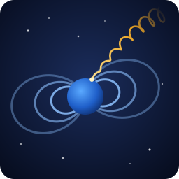

<p align="center">
  
</p>

# COR-Engine: Trajectory simulation of cosmic rays in the Earth's magnetosphere

`cor` (cor-engine) traces cosmic-ray particle trajectories through the Earth's magnetosphere. It computes cutoff rigidities, which describe the spectrum of allowed and forbidden rigidities at a given location. It can also compute a single particle trajectory, or map the geomagnetic field on a latitude/longitude grid.

The total geomagnetic field is the sum of up to three models:

-   **Internal (core) field** - IGRF (gen. 9 - 14), CHAOS core field (7.16 - 7.18, 8.1 - 8.3), a historical model and CALS10k.2
-   **External (magnetospheric) field** - Tsyganenko 96 (T96) and Tsyganenko-Sitnov 05 (TS05)
-   **Crustal field** - CHAOS crustal field (7.16 - 7.18, 8.1 - 8.3)

This program is the successor of [Trajectories_IGRF_T04_C](https://github.com/COR-Cut-off-rigidity/Trajectories_IGRF_T04_C). That program was developed as a refactoring of the _Institute of Experimental Physics, Slovak Academy of Sciences_ Fortran code.

> This is part of the [cor.crmodels.org](https://cor.crmodels.org/) project.

## Build instructions for Linux

For building your own executable binary, you need to have installed the following prerequisites:

-   [CMake](https://cmake.org/) - v3.10 or newer
-   [Make](https://www.gnu.org/software/make/)
-   [GCC](https://gcc.gnu.org/) with OpenMP support and a C17 compiler
-   glibc (the program uses `argp` for command-line parsing)

You can install these packages with the following commands for your distribution. Run them as the "root" user or with `sudo`.

### Debian

```bash
sudo apt update
sudo apt install gcc make cmake
```

### Fedora

```bash
sudo dnf install gcc make cmake
```

### Arch Linux

```bash
sudo pacman -Sy gcc make cmake
```

### Building the program

Assuming you have already cloned this repository (or downloaded and extracted the ZIP archive) and installed the necessary packages:

1. Navigate to the project directory
2. Type `./build.sh` into the terminal
3. Executable binary `cor` will be created inside the `build/src` directory

After the first build, you can rebuild with `cmake --build build`.

The program is compiled with `-O3 -march=native`, so the binary is optimized for the CPU of the build machine. It may not run on a different CPU.

## How to run the simulation

```
./build/src/cor [OPTION...] INFILE
```

`INFILE` is the file that contains data necessary for the simulation. The options are:

| Option | Description |
| --- | --- |
| `-m`, `--mode=MODE` | Calculation mode: `cutoff`, `trajectory` or `field` (default: `cutoff`) |
| `-o`, `--output=FILE` | Write results to `FILE` instead of standard output. Required for the `trajectory` mode |
| `-p`, `--par` | Parallel computation (OpenMP) |
| `-t`, `--particle-type=TYPE` | Particle type: `proton` or `electron` (default: `proton`) |
| `-i`, `--internal-field=MODEL` | Internal field model (see below) |
| `-e`, `--external-field=MODEL` | External field model (see below, default: none) |
| `-c`, `--crustal-field=MODEL` | Crustal field model (see below, default: none) |
| `--steps-limit=LIMIT` | Max. number of steps for single trajectory calculation (default: `25000`) |
| `--epsilon=RAD` | Max. change of the velocity direction in one step, in rad. Smaller values give higher trajectory precision (default: `0.01`) |
| `--nk-limit=LIMIT` | Max. number of steps per gyration period. Larger values give higher trajectory precision (default: `50000`) |
| `-?`, `--help` | Show help |
| `-V`, `--version` | Show program version |

The supported models are:

| Category | Option | Values |
| --- | --- | --- |
| Internal | `-i` | `igrf9`, `igrf10`, `igrf11`, `igrf12`, `igrf13`, `igrf14`, `chaos7.16`, `chaos7.17`, `chaos7.18`, `chaos8.1`, `chaos8.2`, `chaos8.3`, `hist`, `cals10k.2` |
| External | `-e` | `t96`, `ts05` |
| Crustal | `-c` | `chaos7.16`, `chaos7.17`, `chaos7.18`, `chaos8.1`, `chaos8.2`, `chaos8.3` |

If no model is given, `igrf14` is used. Always give an internal model when you use an external or crustal model.

### Examples

Cutoff rigidities with IGRF-14 and TS05, in parallel mode, with a maximum of 25000 steps for single trajectory calculation:

```sh
./build/src/cor -m cutoff -i igrf14 -e ts05 -p --steps-limit 25000 -o outfile infile
```

A single trajectory with IGRF-13 and T96. The results are saved to `tragsm_outfile` and `trasph_outfile`:

```sh
./build/src/cor -m trajectory -i igrf13 -e t96 -o outfile infile
```

The geomagnetic field of CHAOS-8.3 (core and crustal field) on a latitude/longitude grid:

```sh
./build/src/cor -m field -i chaos8.3 -c chaos8.3 -o outfile infile
```

In the `trajectory` mode, the `tragsm_` and `trasph_` prefixes are added to the whole `-o` value. Give `-o` a plain file name, not a path.

## Input file example

The input file is a whitespace-separated text file. It has two parts:

1. A header for the calculation mode
2. The parameters of the external field model, if you use one. The internal and crustal models do not read extra lines.

### Cutoff and trajectory modes

```
  2.5000  -1.   20.0000
  1.00     48.66     20.53
            48.66     20.53
 2000  3 28  88 16 00 00
   100   1   1   0.10
   -2   0.37   2.30  -0.80
   0.04   0.03   0.06   0.01   0.03   0.02
```

1. Line: starting rigidity in GV; type of particle (-1 for proton); ending rigidity in GV
2. Line: radius in `Re` - (Earth's radius); geocentric latitude and longitude (of the starting point of the trajectory)
3. Line: geocentric latitude and longitude for the incoming direction of the particle
4. Line: year; month; day; day in year; hours; minutes; seconds in UTC time
5. Line: First 3 numbers - parameters for trajectory division; rigidity step
6. Line: `Dst` index (in `nT`); `pdyn` - dynamic pressure of solar wind (in `nPa`) at given date and time; the intensity of `y` and `z` components of the interplanetary field at a given date and time
7. Line: W1 - W6 input parameters for external geomagnetic field model (Tsyganenko) which describes the prehistory of the geomagnetic field.

For the `trajectory` mode, the starting and ending rigidity must be equal.

### Field mode

```
  1.00  -90.0    0.0
  10.0   10.0   90.0  360.0
 2025  1  1   1  0  0  0
```

1. Line: radius in `Re`; starting geocentric latitude and longitude
2. Line: latitude step; longitude step; ending geocentric latitude and longitude
3. Line: year; month; day; day in year; hours; minutes; seconds in UTC time

The grid includes the ending latitude, but not the ending longitude. If you use an external model, add its parameter lines (line 6 and 7 of the cutoff input file) after line 3.

## Output file example

### Cutoff mode

```
                ASYMPTOTIC COORDINATES
   calculated by model(s): IGRF-14, Tsyganenko-Sitnov 05
 Station with geo.latitude:   48.660  & longitude:   20.530 & radius :  1.00000
 Direction of trajectory with latitude:    48.660 & longitude:    20.530
 Date: 2000  3 28  time: 16 hod  0 min  0 sec
 Starting rigidity :   2.5000 GV Epsilon= 0.0100
 Limit of total number of steps : 25000 

 rig : v : rad : eth : efi : ath : afi : time : length
  3.340000   0.9627671971   14.775332    -0.386    27.632    11.857    52.832    2.338130       675165.88
  3.350000   0.9629769771   11.041272   -16.745   321.804   -13.210   359.002    1.431728       413418.93
  ...
 19.990000   0.9989013152   23.845452    15.014    66.103    12.726    69.747    0.480326       148475.76
 20.000000   0.9989024118   23.836856    15.023    66.103    12.748    69.752    0.476608       148574.08
  CUTOFF with rigidities P(S),P(C),P(M) are:
     3.34000     4.10000     3.73000
```

This file consists of 3 parts:

-   Header - contains simulation metadata (models, geographic coordinates, date and time, Epsilon - step in rigidity, the maximum number of steps for back-tracing of one trajectory)
-   Calculated data - one line for each allowed trajectory. Forbidden rigidities are not listed.
    1. `rig` - rigidity in GV
    2. `v` - velocity of the particle in units of the speed of light
    3. `rad` - radius of the "end point" (at the magnetopause, or in the tail at the sphere with radius 25 Re) in Re
    4. `eth` - latitude of the "end point" in the geocentric coordinate system
    5. `efi` - longitude of the "end point" in the geocentric coordinate system
    6. `ath` - latitude of the asymptotic direction in the geocentric coordinate system
    7. `afi` - longitude of the asymptotic direction in the geocentric coordinate system
    8. `time` - time of flight of the particle from the starting point to the end point in seconds
    9. `length` - length of the whole trajectory from the starting point to the end point in km
-   Footer - the last line includes 3 values in GV: the lower cutoff rigidity P(S), the upper cutoff rigidity P(C) and the effective cutoff rigidity P(M).

### Trajectory mode

The program writes two files, with one line for each integration step:

-   `tragsm_<outfile>` - position in GSM coordinates
-   `trasph_<outfile>` - position in geocentric spherical coordinates

```
     1          1.00085         48.66000         20.53000  294587882.58   0.0000183445           5404.10
     2          1.00170         48.65998         20.53048  294587882.58   0.0000367350          10821.79
     3          1.00255         48.65993         20.53144  294587882.58   0.0000551719          16253.12
```

-   Column 1 - step number
-   Columns 2 - 4 - position: `x`, `y`, `z` in m (`tragsm_`), or radius in Re, latitude and longitude in degrees (`trasph_`)
-   Column 5 - velocity of the particle in m/s
-   Column 6 - time of flight from the starting point in seconds
-   Column 7 - length of the trajectory from the starting point in m

### Field mode

```
                GEOMAGNETIC FIELD
 Geomagnetic Model(s): IGRF-14
 lat step: 10.000, lon step: 10.000
 Date: 2025  1  1  time:  0 h  0 min  0 sec

 lat : lon : B [nT] : BXGEO [nT] : BYGEO [nT] : BZGEO [nT]
   -90.00      0.00 53278.895220 14192.529872    0.000004 -51353.799973
   -90.00     10.00 53278.895220 14192.529872    0.000004 -51353.799973
  ...
```

Each line gives the geocentric latitude and longitude, the magnitude of the magnetic field `B` and its `x`, `y`, `z` components in the geographic (GEO) Cartesian coordinate system. All field values are in nT.

## License

This project is licensed under the GNU General Public License v3.0. See [LICENSE](LICENSE) for details.
